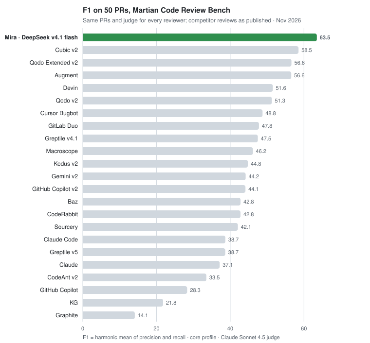
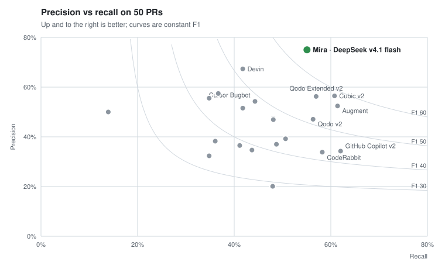

<p align="center">
  
</p>

<h1 align="center">Mira</h1>

<p align="center">
  <strong>Self-hosted AI code review. Your code, your dashboard, your LLM key.</strong>
</p>

<p align="center">
  <a href="https://docs.miracode.ai"></a>
  <a href="https://discord.gg/uEU6qvYhgm"></a>
</p>

<p align="center">
  <a href="https://docs.miracode.ai">Docs</a> ·
  <a href="https://discord.gg/uEU6qvYhgm">Community</a> ·
  <a href="https://docs.miracode.ai/deployment"><strong>Self-Host Guide »</strong></a> ·
  <a href="#benchmark">Benchmark</a>
</p>

Self-host every feature: full review engine, codebase indexing, vulnerability scanning, custom rules, org-wide package search, dashboard, learning loop. No paid tier, no license key, no SaaS upsell.

Mira reviews your pull requests using your choice of LLM (via [OpenRouter](https://openrouter.ai), which fronts Anthropic, OpenAI, Google, DeepSeek, and more) and posts concise, actionable feedback. The noise filter, confidence clamping, and learning loop ensure you only see comments that matter. See [`FEATURES.md`](FEATURES.md) for the full surface.

## Why Teams Choose Mira

- **Model agnostic** — Run Claude, GPT, Gemini, GLM, DeepSeek, Llama, or any OpenAI-compatible endpoint: OpenRouter, Z.AI, vLLM, Ollama, Together, Groq, Fireworks, or AWS Bedrock direct. Per-provider quirks are config, not code, so adding a provider is a one-line entry.
- **Zero markup on LLM costs** — Bring your own key. You pay the model provider directly; Mira never proxies your spend or adds a multiplier. The dashboard shows real per-repo, per-model cost — not estimates.
- **Learns from your context** — Mira synthesizes rules from your merged PRs: rejected comments and human review patterns become team rules that shape future reviews.
- **You set the rules** — Define custom and org-wide review rules in plain language, per-repo via `.mira.yaml` or from the dashboard.
- **Privacy first** — Self-hosted by default. Diffs, indexes, review history, and CVE data live in your SQLite or Postgres, on infra you own. No phone-home, no required telemetry, no "is this used for training?"
- **Low-noise reviews** — Confidence thresholds, dedup, a self-critique pass, and per-PR caps mean every comment is one worth reading — Mira has the best precision of any top-tier tool on the public [Code Review Bench](#benchmark), on a model that costs cents per review.
- **Catches PRs stepping on each other** — While reviewing, Mira checks the repo's other open PRs and flags merge-conflict risk and duplicate effort right in the walkthrough.
- **Indexed, cross-file context** — A full-repo code index gives the model real project context, not just the diff — plus org-wide package search and hourly OSV.dev CVE scanning across every repo.
- **GitHub, GitLab, Forgejo, and Bitbucket Cloud** — Auto-reviews every PR and merge request and answers `@miracodeai` questions inline across GitHub, GitLab, Forgejo (incl. Codeberg), and Bitbucket Cloud. The engine, indexer, and dashboard are provider-agnostic, so a new host is a data entry plus one provider class.
- **Self-host on day one** — Docker image with Railway / Fly.io / Render configs, SQLite or Postgres. Every feature included.

## Dashboard


## Your data, your dashboard

Most AI reviewers are SaaS: your diffs (and often the full surrounding code) leave for a third-party server, and the only "view" you get is the comments that come back on a PR. Mira flips both halves of that:

- **Your code never leaves your infra.** Diffs, embeddings, indexes, review history, vulnerability data, all stored in your SQLite or Postgres, on infrastructure you own. No phone-home, no required telemetry, no "is this used for training?" question.
- **The dashboard you see above is yours.** It's not a marketing screenshot of someone else's view of your code. CodeRabbit, Greptile, and similar SaaS reviewers don't expose anything like it. Mira's dashboard surfaces signals you don't get anywhere else:
  - **Org-wide package inventory**: answer "which repos use `lodash@4.17.20`?" in one query. Stack it next to your CVE feed for instant blast-radius checks.
  - **CVE alerts on every dependency**: hourly OSV.dev poll, severity + advisory link + fix version surfaced inline next to the package.
  - **Dependency + blast-radius graphs**: see exactly which files and repos depend on a symbol before you change it.
  - **Per-repo review event stream**: every webhook, every chunk, every cost figure, in one place for live troubleshooting.
  - **Cost & token telemetry**: actual spend per repo and per model, not estimates, because you control the LLM key.
  - **Review-health page**: stale/waiting PRs, a reviewer-responsiveness leaderboard, throughput trends, and rubber-stamp detection (approvals with no substantive review) — plus per-contributor analytics with a year-long heatmap and Mira's review-quality signal.
  - **Coming soon, change-frequency heatmaps**: surface the files that bug fixes keep landing on so you can target review attention.

If your engineering team needs answers like *"which of our repos are exposed to this CVE?"* or *"what's the blast radius of changing this function?"*, those questions stop being multi-day investigations and start being one-click dashboard pages.

## Benchmark

On the **full 50-PR offline set** of the public [Martian Code Review Bench](https://github.com/withmartian/code-review-benchmark/tree/e616e849755441da38f18bf3adba2c9583b03803/offline), Mira running an inexpensive model (**DeepSeek v4.1 flash**) ranks **first on F1 of 23 published reviewers** and posts the fewest unmatched comments of any tool above 50% recall. Run on 6 November 2026.

<picture>
  <source media="(prefers-color-scheme: dark)" srcset=".github/assets/benchmark-f1-dark.svg">
  
</picture>

| Reviewer | Precision | Recall | F1 | TP / FP / FN |
|---|---:|---:|---:|---|
| **Mira · DeepSeek v4.1 flash** | **75.0%** | 55.1% | **63.5** | 87 / 29 / 71 |
| Cubic v2 | 56.5% | 60.8% | 58.5 | 96 / 74 / 62 |
| Qodo Extended v2 | 56.2% | 57.0% | 56.6 | 90 / 70 / 68 |
| Augment | 52.4% | 61.4% | 56.6 | 97 / 88 / 61 |
| Devin | 67.3% | 41.8% | 51.6 | 66 / 32 / 92 |
| Qodo v2 | 47.1% | 56.3% | 51.3 | 89 / 100 / 69 |
| Cursor Bugbot | 54.3% | 44.3% | 48.8 | 70 / 59 / 88 |
| GitLab Duo | 47.5% | 48.1% | 47.8 | 76 / 84 / 82 |
| Greptile v4.1 | 46.9% | 48.1% | 47.5 | 76 / 86 / 82 |
| GitHub Copilot v2 | 34.3% | 62.0% | 44.1 | 98 / 188 / 60 |
| CodeRabbit | 33.8% | 58.2% | 42.8 | 92 / 180 / 66 |
| Claude Code | 36.5% | 41.1% | 38.7 | 65 / 113 / 93 |

The full ranking of all 23 reviewers, per-PR results, head commits and settings are in [`benchmark-results.json`](.github/assets/benchmark-results.json).

<picture>
  <source media="(prefers-color-scheme: dark)" srcset=".github/assets/benchmark-pr-dark.svg">
  
</picture>

Mira sits furthest up on the precision axis at a recall most tools don't reach: the tools that find a few more bugs (Cubic, Augment, Copilot, CodeRabbit) post two to six times as many comments that match nothing in the reference set.

Median review time was **106 seconds** per PR; all 50 reviews completed.

> Methodology: all 50 PRs of the [Martian Code Review Bench](https://codereview.withmartian.com/?mode=offline) offline dataset, reviewed once each with Mira's default settings (reasoning effort `medium`, 16k-token output budget) and scored with the benchmark's own matching prompts and Claude Sonnet 4.5 as the judge; competitor rows are the benchmark's published results on the same PRs. Settings, per-PR results and commit pins are in [`benchmark-results.json`](.github/assets/benchmark-results.json).

## Quick Start

Run Mira self-hosted to auto-review every PR and merge request and answer `@miracodeai` questions inline. GitHub (as a GitHub App), GitLab (via a group/project access token), Forgejo/Codeberg (via an access token), and Bitbucket Cloud (via an access or API token) are all supported.

**1. Deploy** — one-click on Railway, or with Docker:

[](https://railway.com/workspace/templates/05874bad-2d98-43f4-aa93-332f394e9ebd)

```yaml
# mira.yaml — deployment-wide defaults. Every key is optional.
llm:
  model: "anthropic/claude-sonnet-4-6"
  indexing_model: "anthropic/claude-haiku-4-5"
```

```bash
# .env — secrets only.
MIRA_GITHUB_APP_ID=123456
MIRA_GITHUB_PRIVATE_KEY="$(cat private-key.pem)"
MIRA_WEBHOOK_SECRET=your-secret
OPENROUTER_API_KEY=sk-or-...
```

```bash
docker run -p 8000:8000 --env-file .env \
  -v "$(pwd)/mira.yaml:/app/mira.yaml" \
  ghcr.io/miracodeai/mira:latest --config /app/mira.yaml
```

**2. Install the app** on your repos — every PR gets reviewed.

**Bitbucket Cloud** — instead of the GitHub App creds, set:

```bash
# A workspace/project/repository access token (Bearer), or an API token as email:token.
# Scopes: repository read, pull requests read+write, webhooks read+write.
MIRA_BITBUCKET_TOKEN=ATCTT3x...
MIRA_BITBUCKET_WEBHOOK_SECRET=your-secret
MIRA_BITBUCKET_WORKSPACE=your-workspace   # optional: dashboard repo discovery scope
MIRA_BITBUCKET_BOT_USER=mira              # optional: bot nickname if the token can't read /user
```

Then add a workspace (or repository) webhook pointing at `https://<mira-host>/bitbucket/webhook` with the same secret and the triggers *Repository: Push*, *Pull request: Created, Updated, Merged, Comment created*. Bitbucket PRs have no labels, so `@mira pause` state is kept in Mira's database. Comment commands check repository permission through the workspace permissions API, which needs admin rights; otherwise list reviewers' account ids in `commands.allowed_users`. Bitbucket nicknames are not unique, so authorization and the allowlist match the commenter's account id, never the nickname.

→ Full walkthrough: [creating the GitHub App & quickstart](https://docs.miracode.ai/quickstart) · [GitLab setup](https://docs.miracode.ai/gitlab) · [deploy options](https://docs.miracode.ai/deployment) · [choosing models, custom endpoints & AWS Bedrock](https://docs.miracode.ai/configuration/models)

### Z.AI GLM

Mira can call GLM-5.2 directly through Z.AI's OpenAI-compatible Chat
Completions API. Set `base_url` to the endpoint for your Z.AI key:

- General API key: `https://api.z.ai/api/paas/v4`
- GLM Coding Plan key: `https://api.z.ai/api/coding/paas/v4`

```yaml
# mira.yaml
llm:
  provider: "openai"
  api_style: "chat"
  base_url: "https://api.z.ai/api/paas/v4"   # or https://api.z.ai/api/coding/paas/v4
  api_key_env: "ZAI_API_KEY"
  model: "glm-5.2"
  indexing_model: "glm-5.2"
  review_model: "glm-5.2"
```

```bash
# .env
ZAI_API_KEY=your-zai-api-key
```

Both endpoints use the same wire format, so the bundled `zai` provider profile
covers either one: Mira controls thinking with `thinking.type` plus a top-level
`reasoning_effort`, sends `tool_choice: "auto"`, and the dashboard offers the
curated GLM model list. Keys are tied to their plan, so match the endpoint to
your key — a Coding Plan key sent to the general endpoint fails with an
insufficient-balance error.

### Codex CLI

If you already use OpenAI Codex locally, Mira can run reviews through the
Codex CLI instead of an HTTP API key. Authentication stays inside Codex via
`CODEX_HOME/auth.json`, created by `codex login`:

```yaml
# mira.yaml
llm:
  provider: "codex-cli"
  model: "codex-default"      # use the Codex CLI default model
  codex_home: "/run/codex"    # optional; defaults to CODEX_HOME
  codex_sandbox: "read-only"  # the only accepted sandbox policy
  codex_timeout_seconds: 900  # optional
```

The official Mira image includes a pinned Codex CLI. Log in to a directory that
only Mira uses, then mount that directory writable so Mira can save refreshed
tokens (see [Keeping the Codex login fresh](#keeping-the-codex-login-fresh)):

```bash
CODEX_HOME="$(pwd)/codex-home" codex login
docker run -p 8000:8000 --env-file .env \
  -e CODEX_HOME=/run/codex \
  -v "$(pwd)/codex-home:/run/codex" \
  -v "$(pwd)/mira.yaml:/app/mira.yaml:ro" \
  ghcr.io/miracodeai/mira:latest --config /app/mira.yaml
```

This provider does not require `OPENROUTER_API_KEY`.

#### Isolation guarantees

The review prompt contains untrusted pull-request content, so Mira assumes a
prompt-injected model and gives it no way to act beyond writing its answer:

- **No tools that read files, run commands, or reach the network.** Codex runs
  with its shell and exec tools (`shell_tool`, `unified_exec`), image viewer
  (`view_image`), sub-agents (`multi_agent`, `multi_agent_v2`), code mode, apps,
  plugins, browser and computer use, image generation, and hooks disabled, and
  with web search off. A model that calls one of these tools anyway gets
  `unsupported call` back and nothing runs.
- **Fail closed on Codex upgrades.** Tools are switched off with `--disable`,
  which rejects unknown feature names. If a Codex release renames or drops one,
  reviews fail with `Unknown feature flag` instead of running with the tool on.
  Tested with Codex 0.154.0, the version pinned in the official image. Releases
  before the `view_image` feature flag existed can't disable the image viewer
  and refuse to start.
- **No inherited configuration.** `$CODEX_HOME/config.toml`, user and project
  `.rules` files, and shell environment inheritance are ignored. Mira copies
  only `auth.json` from the mount into a private temporary Codex home, runs
  Codex in an empty temporary workspace with an allow-listed environment (no
  Mira, GitHub, or database credentials), and discards both afterwards
  (`--ephemeral`). The only thing that flows back is a refreshed login, saved
  to the mounted `auth.json` (see
  [Keeping the Codex login fresh](#keeping-the-codex-login-fresh)).
- **No writes.** The `read-only` sandbox stays on as a second layer.

What these guarantees do **not** cover:

- The read-only sandbox blocks writes, not reads. Mira's file-safety comes from
  the model having no file or shell tool, not from the sandbox. Before tools
  were disabled, a canary test with a working sandbox showed an injected model
  could `cat` a planted `/run/secrets` key and echo it into the review.
- The Codex process itself runs with the Mira container's user and can read
  whatever that user can, including its own copy of `auth.json`. Run the
  container as a non-root user and keep unrelated secrets out of it as defense
  in depth.
- The prompt, including pull-request content and Mira's instructions, is sent
  to OpenAI, and the model can put any of it in its answer.
Provider choice, executable/auth paths, sandbox policy, and timeout are
deployment-only settings; repository `.mira.yaml` files cannot override them.
For one-shot `mira review` runs, `--config` is treated as untrusted by default.
An operator-owned config may opt in with `--trust-execution-settings`; never use
that flag with a repository-controlled file.

Codex CLI does not expose Mira's temperature or hard output-token controls, so
Mira disables ensemble sampling for this provider. The mounted OAuth session is
still a sensitive deployment credential: use a dedicated Codex account/session
and isolate the Mira container from unrelated host files and services.

#### Keeping the Codex login fresh

A ChatGPT login in `auth.json` holds an access token and a single-use refresh
token. Codex refreshes the login shortly before the access token expires
(currently every 10 days) and writes the new tokens to its own `auth.json`,
which for Mira is the temporary copy. Mira saves that refresh back to the
mounted `auth.json`:

- **As soon as it happens.** Mira checks the copy every second while Codex runs
  and once more after Codex exits, including runs that fail, time out, or are
  cancelled. Nothing else from the temporary Codex home is written back.
- **Only if it is newer.** The copy is saved only when it changed, parses as a
  login for the same account as the mounted file, and has a later
  `last_refresh` than the mounted file. A login that another run saved later,
  or a login for a different account, is never overwritten.
- **Atomically, under a lock.** Mira holds an exclusive lock on
  `.mira-auth.lock` while it compares and replaces `auth.json`: it writes a
  temporary file with mode `0600` and renames it over the old one.
- **One refresh at a time.** A run whose access token could expire before
  `codex_timeout_seconds` elapse first takes `.mira-auth-refresh.lock`. Other
  such runs wait (for at most that timeout) and then start from the refreshed
  login instead of spending the same refresh token again. Runs with a fresh
  token never wait.

The mounted *directory* must be writable, because Mira replaces `auth.json` by
renaming and creates its lock files next to it. A read-only mount, or a mount of
the `auth.json` file alone, still works for an API-key login, but a ChatGPT
login breaks at its first refresh: Mira logs `Codex refreshed its login but Mira
could not save it`, and later runs fail with "refresh token was already used".
To recover, run `CODEX_HOME=<mounted dir> codex login` again.

Don't mount your personal `~/.codex`. The container could read and change your
other Codex state, and your own Codex sessions don't take Mira's lock, so they
can spend the same refresh token as Mira.

### Claude CLI failover

Mira can fail over from its primary provider to Claude through the Claude Code
CLI, authenticated with a Claude subscription instead of an Anthropic API key.
Create a long-lived token with `claude setup-token` and pass it to the container
as `CLAUDE_CODE_OAUTH_TOKEN`:

```yaml
# mira.yaml
llm:
  base_url: "https://api.z.ai/api/paas/v4"   # primary provider, unchanged
  api_key_env: "ZAI_API_KEY"
  model: "glm-5.2"
  failover_cooldown_seconds: 600    # skip the primary this long after a provider-side failure
  failover_primary_max_retries: 1   # retry the primary less so failover happens quickly
  failover:
    provider: "claude-cli"
    model: "sonnet"
    max_context_tokens: 1000000
    claude_oauth_token_env: "CLAUDE_CODE_OAUTH_TOKEN"   # optional; this is the default
    claude_max_concurrency: 2                           # optional
```

A call that fails on the primary is re-sent to the failover provider. Rate
limits, 5xx responses, timeouts, network errors, and auth errors also put the
primary into a cooldown, so later calls go straight to the failover provider
until it expires. Dashboard model overrides apply to the primary only; the
failover provider uses the models in its own block. `provider: "claude-cli"`
also works on its own, without failover.

The official Mira image includes a pinned Claude Code CLI. Each call runs
`claude -p` in an empty temporary directory with a minimal environment — only
the subscription token is passed, never `ANTHROPIC_API_KEY` or Mira's service
credentials — and with no tools, MCP servers, hooks, settings, slash commands,
or saved session. Provider choice, the token variable, and all failover settings
are deployment-only, as are `base_url` and `api_key_env`: repository
`.mira.yaml` files cannot set them. Automated use draws on the subscription's
usage limits; `claude_max_concurrency` caps how many CLI processes run at once.

## Configuration

`mira.yaml` (loaded via `--config`) holds deployment-wide defaults. Drop a `.mira.yaml` in any repo — or use the dashboard — to override per-repo; both deep-merge over `mira.yaml` for that repo only:

```yaml
# .mira.yaml — optional per-repo override
filter:
  confidence_threshold: 0.5  # noisier repo → lower bar
  max_comments: 10
```

→ Full schema and every key: [Configuration docs](https://docs.miracode.ai/configuration).

## Development

```bash
git clone https://github.com/miracodeai/mira.git
cd mira
pip install -e ".[dev,serve]"

# Run tests
pytest tests/ -v

# Run the regression suite (hits real GitHub + LLM, ~$1, ~3 min).
# Pinned PRs whose findings have flickered across iterations. Run before
# merging changes that touch prompts, the noise filter, or the engine.
OPENROUTER_API_KEY=... GITHUB_TOKEN=... pytest -m eval -v

# Lint
ruff check src/ tests/

# Type check
mypy src/mira/ --ignore-missing-imports
```

## License

Apache 2.0. See [LICENSE](LICENSE).
